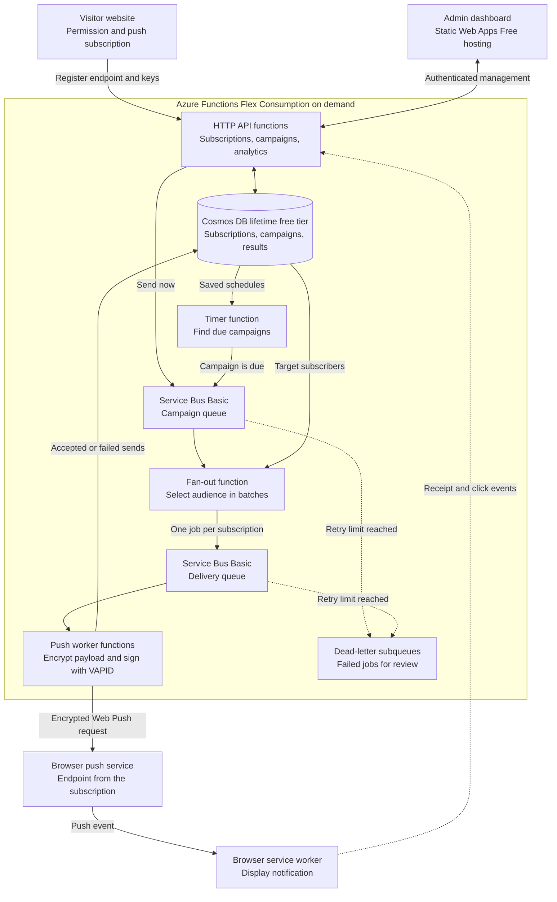

# Serverless Web Push Notification Service Dashboard

This proposed architecture turns the dissertation outline into an Azure implementation plan with near-zero running cost as a core constraint. Develop locally without cloud charges, use free allowances for a small hosted demonstration, and run large benchmarks as bounded experiments. The plan does not depend on temporary trial credits and does not promise a zero Azure bill.

The dashboard manages subscribers, segments, campaigns, schedules, and analytics. Browser subscriptions remain in the project's database; notifications travel through the push service selected by each browser.

The [implementation plan](implementation-plan.md) defines the milestones, target dates, build order, validation, and cost controls.

## How the system works

1. **Subscribe.** On the visitor's explicit action, the website requests permission, registers a service worker, and creates a Push API subscription using the public VAPID key. It sends the subscription endpoint and encryption keys to the API for storage. Unsubscribing deactivates the stored subscription.
2. **Prepare a campaign.** An authenticated administrator writes a notification, chooses a segment, and sends it immediately or saves a future send time. The API stores the campaign and its status.
3. **Dispatch the campaign.** Immediate campaigns enter the campaign queue. A timer function queries saved schedules and enqueues due campaigns. The fan-out function reads the selected audience in pages and creates delivery jobs. Campaign claims and resumable progress prevent overlapping dispatchers from repeatedly expanding the same campaign.
4. **Send notifications.** Queue-triggered workers load each subscription, encrypt the payload, sign the Web Push request with VAPID, and send it to that subscription's browser push endpoint. These browser-operated push services remain part of the Web Push protocol even though campaign management is self-hosted.
5. **Handle failures.** Retry temporary failures with bounded backoff and provider rate limits. Deactivate expired subscriptions, such as endpoints returning HTTP 404 or 410. Persist terminal send failures. Queue messages that cannot be processed after the retry limit move to their parent queue's dead-letter subqueue for inspection.
6. **Report results.** Workers record accepted and failed send attempts in Cosmos DB. The service worker reports receipt and click events when available, and the dashboard reads aggregated campaign analytics through the API. Push-service acceptance is a separate metric from device receipt or user interaction; client reporting is best effort.

## Supporting services

- Host the dashboard and a demonstration subscriber website on Azure Static Web Apps Free using the provided domain. Deploy the API, scheduler, and workers in a separate Azure Functions app. The frontend calls the API's HTTPS endpoint directly with explicitly configured CORS. This avoids the Standard-plan requirement for linking an existing Functions app through Static Web Apps.
- Protect administrator APIs with validated identity-provider tokens and administrator authorization in the backend. Expose only the required subscription and event routes to visitors. Frontend hosting authentication alone does not authorize requests to the separate backend.
- Store the private VAPID key in backend secret configuration, outside source control and the frontend bundle. Publish only the public VAPID key to subscriber websites. Key Vault is an optional later addition, rather than a required baseline resource.
- Use sampled Application Insights telemetry for failures and latency, with low ingestion volume and daily caps as a secondary safeguard. Keep detailed campaign data in the database with bounded retention. Use Azure Cost Management for the cost comparison. Azure Functions also requires its host storage account.
- Use infrastructure as code and a CI/CD pipeline for repeatable deployment.
- Make queue consumers idempotent using campaign and subscription identifiers, and use notification tags or client-side identifiers to limit duplicate displays. Do not promise exactly-once Web Push delivery.

## Near-zero cost configuration

Allowances below were checked against Microsoft documentation on 18 November 2026. Availability, subscription eligibility, regional prices, and usage must be checked again at deployment.

| Component | Baseline choice | Cost constraint |
| --- | --- | --- |
| Dashboard hosting | Static Web Apps Free | Free within its quotas; use the provided domain. |
| API, scheduler, workers | One Flex Consumption Functions app using on-demand instances | Eligible subscriptions receive 250,000 executions and 100,000 GB-seconds monthly, shared across the subscription. Configure zero Always Ready instances. Excess use is billed. |
| Database | Cosmos DB lifetime free tier with one region and one shared-throughput database | Enable free tier when creating the account; keep total provisioned throughput at or below 1,000 RU/s and storage at or below 25 GB. Disable autoscale for this baseline. |
| Campaign and delivery queues | One Service Bus Basic namespace with two queues | Metered operations; Basic has no Standard-tier hourly base charge. Queue operations are not a free allowance. Application logic must handle idempotency because Basic has no broker duplicate detection. |
| Functions host storage | Standard locally redundant storage | Small usage-based storage and transaction charges remain outside the Functions free grant. |
| Monitoring | Sampled logs and minimal retained data | Filter and sample before ingestion; use daily caps as a safeguard. Do not log each payload or subscriber record. |

Cosmos DB's lifetime free tier applies to provisioned-throughput accounts, not serverless accounts. The compute and queue workers remain serverless; the database uses managed provisioned throughput to access the free allowance. Only one Cosmos DB free-tier account is available per subscription. If that allowance is unavailable, reassess the database choice before creating a paid account.

Keep normal demonstrations to a small audience. Add configurable limits for campaign size, daily send attempts, worker concurrency, and retry count, plus a switch that pauses dispatch and sending. Do not enable Premium Functions, Always Ready instances, Service Bus Standard or Premium, a paid hosting plan, or extra regions in the baseline deployment.

Use local development and test doubles for routine logic tests. For a hosted demonstration, the target is to keep hosting, compute, and database usage inside free allowances, leaving only small metered queue, storage, and possible telemetry charges. An exact monthly estimate requires a campaign count, audience size, execution duration, and deployment region.

Configure a low monthly Azure budget and alerts before the first deployment. Budget alerts notify; they do not stop spending. Application limits and telemetry caps also do not constitute a hard cap on the Azure bill.

## Dissertation evaluation

The runtime diagram covers browser Web Push. A separate load-test harness will exercise simulated audiences up to 100,000 subscribers and compare the Azure implementation with an always-on server using the same payloads, audience sizes, and measurement definitions. Use a controlled mock push endpoint for large synthetic runs, and report those measurements separately from real browser delivery. Use real cross-browser notification flows with a small audience for functional validation. Run cloud benchmarks for a fixed duration and job count, then remove temporary benchmark resources. Do not keep an always-on comparison server running between experiments.

Report latency, accepted sends, observed receipts, failures, and cost separately. Native mobile push is outside the outline's scope.

## Design basis

The attached dissertation outline specifies Azure Functions, browser Push API, service workers, VAPID, queued fan-out, a management dashboard, and benchmarking. The queue split, database layout, hosting, authentication, secrets management, and operational controls above are proposed implementation choices.

- Source outline: `/Users/devlopedbyviv/Downloads/Dissertation_Outline_S1-26_CSIWZG28T_Serverless_Web_Push.docx`
- [W3C Push API](https://www.w3.org/TR/push-api/)
- [Azure Functions Service Bus trigger](https://learn.microsoft.com/en-us/azure/azure-functions/functions-bindings-service-bus-trigger)
- [Azure Functions timer trigger](https://learn.microsoft.com/en-us/azure/azure-functions/functions-bindings-timer)
- [Azure Service Bus dead-letter queues](https://learn.microsoft.com/en-us/azure/service-bus-messaging/service-bus-dead-letter-queues)
- [Azure Static Web Apps pricing](https://azure.microsoft.com/en-us/pricing/details/app-service/static/)
- [Azure Static Web Apps hosting plans](https://learn.microsoft.com/en-us/azure/static-web-apps/plans)
- [Azure Functions pricing and monthly grants](https://azure.microsoft.com/en-us/pricing/details/functions/)
- [Cosmos DB lifetime free tier](https://learn.microsoft.com/en-us/azure/cosmos-db/free-tier)
- [Azure Service Bus pricing and tier features](https://azure.microsoft.com/en-us/pricing/details/service-bus/)
- [Azure Monitor daily caps and sampling](https://learn.microsoft.com/en-us/azure/azure-monitor/logs/daily-cap)
- [Azure Cost Management budgets](https://learn.microsoft.com/en-us/azure/cost-management-billing/costs/tutorial-acm-create-budgets)
