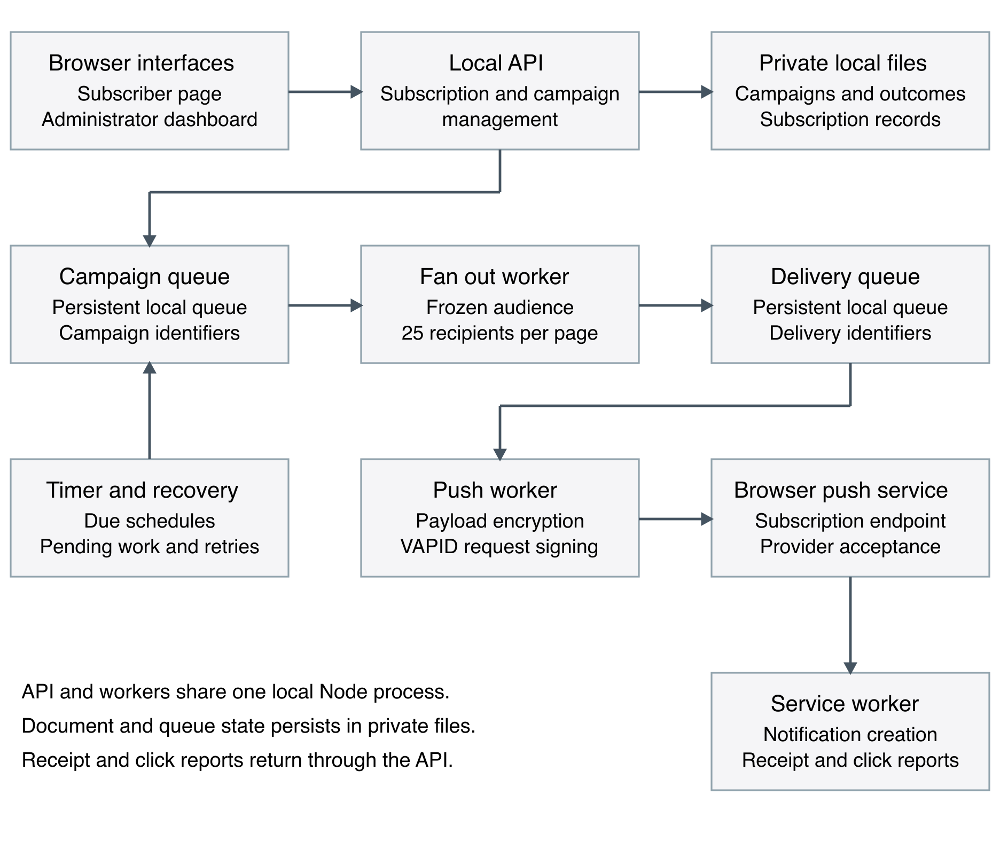
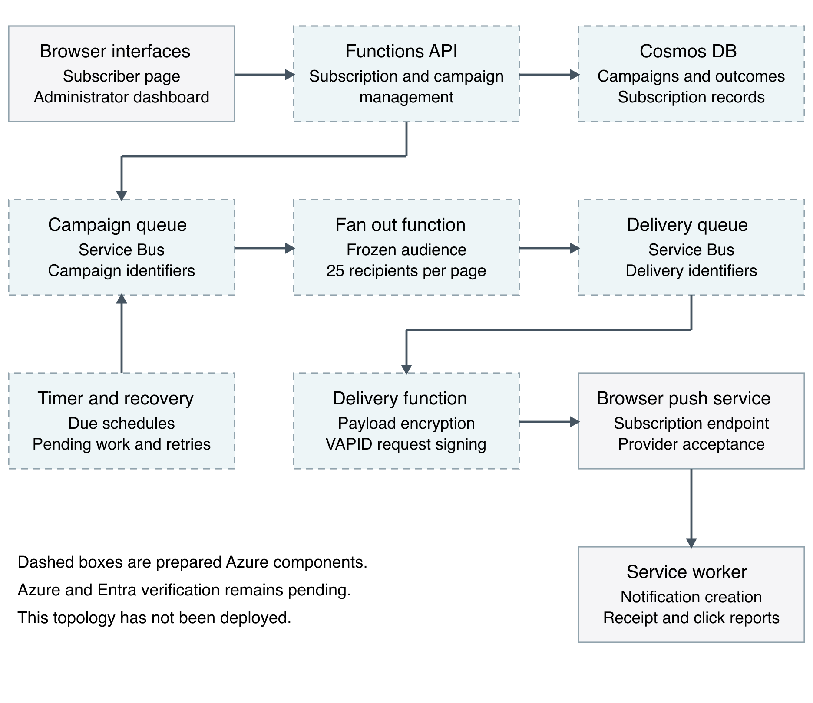
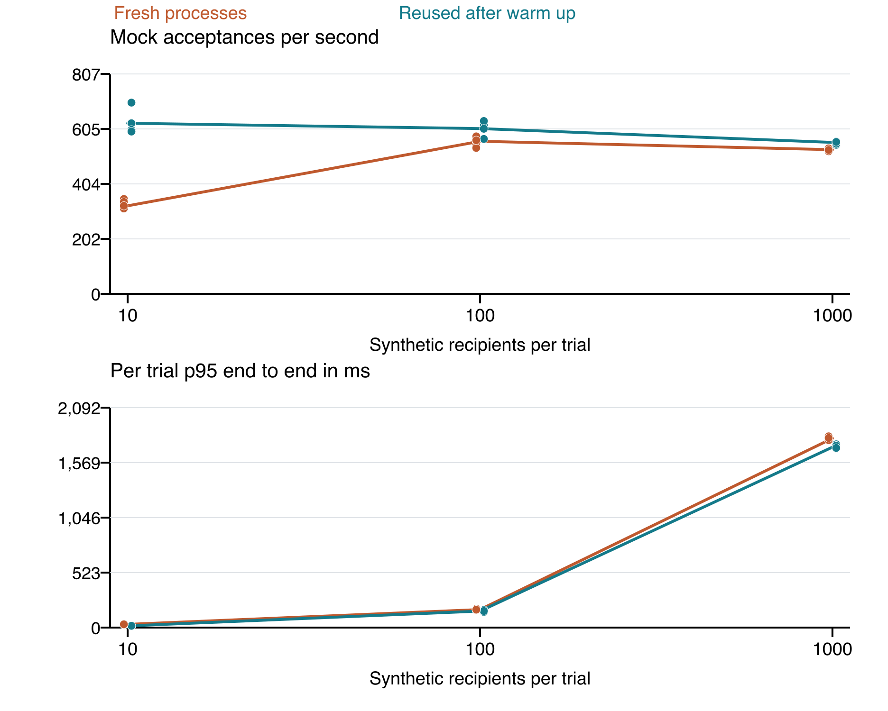
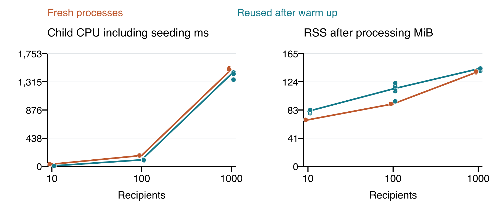
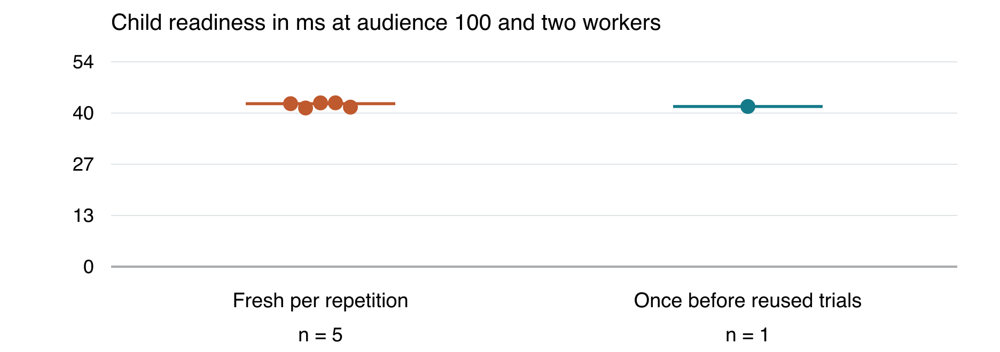

# Serverless Web Push Notification Service Dashboard

Dissertation review draft

This report presents the implemented local prototype and verified exploratory measurements. The original Azure comparison, larger audiences and full browser validation remain open. Academic approval and final submission have not been recorded.

## 1 Abstract and review scope

The project implements a browser push notification service with subscriber registration, campaign management, one-time scheduling, queue-based fan-out, bounded retries and separate acceptance, receipt and click reporting. A React dashboard uses a TypeScript backend and a shared delivery core. File adapters support a persistent local demonstration; Azure Functions, Cosmos DB, Service Bus and Entra adapters are prepared for later verification.

The recorded local experiment compares 10, 100 and 1,000 synthetic recipients at one, two and four delivery workers. Each process condition has five measured repetitions. Across 18 scenarios and 90 measured trials, the mock provider accepted 33,300 deliveries with zero failures. Nine warm-ups, accounting for 3,330 additional acceptances, remain in the raw evidence and are excluded from measured summaries. These results use memory adapters and a controlled loopback HTTP provider. They omit Web Push encryption, real browsers, durable broker I/O and Azure execution.

At 1,000 recipients with reused processes, observed median throughput was 238.12, 556.00 and 889.69 mock acceptances per second at one, two and four workers. These values describe one local session. They do not establish a production capacity, a serverless advantage or statistical significance. The recorded candidate passed 96 automated tests; operating-system notification visibility, real clicking and broad cross-browser behavior remain separate verification tasks.

The strict INR 100 spending decision keeps cloud deployment disabled. Cloud usage, invoices and electricity were not measured, so monetary fields remain unmeasured. This draft requests review of the implementation, the evidence and the proposed treatment of the unfulfilled original objectives. It is not a final approved dissertation.

## 2 Problem and objectives

The engineering problem is to coordinate subscriptions, targeting, sending and observable outcomes while handling partial failures. A provider response alone does not show that a browser displayed a notification or that a person read it. The application therefore records provider acceptance separately from browser-reported notification creation and click observations.

The supplied October 2026 outline proposes an Azure serverless service and comparison with a conventional server at audiences up to 100,000. The current work establishes a local prototype and a reproducible local baseline. The original comparative evaluation remains incomplete; the budget constraint does not by itself amend the academic scope.

| Original objective | Current evidence | Review status |
| --- | --- | --- |
| Understand Web Push and serverless approaches | Protocol sources and a focused literature context | Broader critical literature review still needed |
| Design an Azure architecture | Functions, Cosmos, queue and identity adapters; deployment templates | Prepared, not deployed or cloud verified |
| Build the management dashboard | Local subscriber, campaign, tag, schedule and reporting flows | Implemented locally; UI and device trials incomplete |
| Validate and compare success, latency and cost | 96 recorded tests and a local 18-scenario experiment | Cloud comparison, costs and cross-browser evidence open |

The local research questions are narrower: does the controlled pipeline account for every synthetic recipient, how do descriptive measurements vary across the tested audiences and worker settings, and how do fresh and reused process conditions differ in this session? The evidence can address these questions without answering whether Azure is faster or cheaper than an always-on cloud server.

## 3 Literature context

RFC 8030 defines application-server requests to a push service and delivery toward a user agent. This intermediary explains why self-managed campaign software still depends on the browser's push infrastructure. The report uses that separation when describing provider acceptance and downstream observations. [1](https://www.rfc-editor.org/info/rfc8030/)

RFC 8291 specifies payload protection between the application server and user agent. RFC 8292 describes VAPID identification using signed application-server information. Encryption and identification serve different purposes; the implementation delegates both protocol operations to its Web Push library. The synthetic benchmark bypasses that library and therefore measures neither operation. [2](https://www.rfc-editor.org/info/rfc8291/) [3](https://www.rfc-editor.org/info/rfc8292/)

The dated W3C Push API working draft describes browser subscriptions and service-worker push events. It provides the browser-side design context, while observed device behavior still requires actual testing. The cited version is a work in progress rather than a completed conformance assessment of this prototype. [4](https://www.w3.org/TR/2026/WD-push-api-20261116/)

Jonas and colleagues discuss serverless abstraction and unresolved research challenges. Eismann and colleagues study 89 serverless applications to examine adoption and application characteristics. Their work motivates workload-specific evaluation; neither source supplies a result for this project. The present local process comparison cannot test cloud elasticity or a provider's billing behavior. [6](https://www2.eecs.berkeley.edu/Pubs/TechRpts/2019/EECS-2019-3.html) [7](https://joelscheuner.com/publication/eismann-21-ieeesw/)

Castro and colleagues remain in the preliminary bibliography. Publication metadata was verified, but the full article was not reviewed for this draft. The literature context is a focused reading of protocol material, official documentation, abstracts and an available accepted manuscript. It is not a systematic literature review or a market/pricing survey. No claim about a commercial push provider's charges is inferred from the original outline's motivation. [5](https://research.ibm.com/publications/the-rise-of-serverless-computing)

## 4 Implemented local architecture

The built application serves the frontend and API from one Node process with local workers. Subscriber and administrator operations use different credentials. Persistent document and queue files support restart recovery. A campaign first enters the campaign queue; fan-out creates deterministic delivery jobs; delivery workers invoke the real Web Push sender during a browser demonstration.

The diagram simplifies shared-store access: API, fan-out, delivery and recovery all use the same private local state. Receipt and click reports return through the API. The benchmark replaces the file stores and real sender with memory adapters and a loopback mock; its timing results are not timings of this persistent local demonstration.

## 5 Prepared Azure architecture

The Azure entry point registers HTTP, queue and timer handlers around the shared core. Microsoft documents the code-centric Node programming model used by those handlers. The implementation prepares adapters and packaging; it does not establish that deployed triggers, identity, partitioning or settlement work in a real subscription. [8](https://learn.microsoft.com/en-us/azure/azure-functions/functions-reference-node)

The intended administrator identity is Microsoft Entra, whereas the local dashboard uses expiring paired sessions. Service Bus Basic lacks broker duplicate detection, so the design also uses persisted delivery identities and state checks. Live behavior remains unverified. A crash after provider acceptance can still leave an ambiguous outcome and allow a duplicate; exactly-once delivery is not claimed. [9](https://learn.microsoft.com/en-us/azure/service-bus-messaging/duplicate-detection)

## 6 Application implementation

The shared core contains subscription validation, campaign rules, delivery state, operational pause controls and reporting capabilities. Adapter interfaces separate those rules from local files, memory, Cosmos DB, Service Bus and the Web Push provider. The frontend reads public configuration rather than private signing material.

Draft campaigns support selected subscribers or tag-based audiences. Version checks prevent stale edits. Preview fingerprints bind a reviewed audience to activation, and the activated recipient list is frozen. One-time schedules use explicit UTC timestamps. Cancellation stops work after its next state check; already accepted notifications cannot be recalled.

Fan-out advances through pages of 25 recipients with checkpoints and leases. Delivery jobs use deterministic campaign/subscription identities, reserve attempts and check cancellation and pause state. Temporary failures use bounded retry delays, including Retry-After handling. Confirmed expired endpoints are deactivated. Recovery scans revisit pending dispatch, due schedules and abandoned work; local behavior is tested with controlled failures.

| Demonstration control | Implemented limit |
| --- | --- |
| Real registered browsers | 100 |
| Frozen campaign audience | At most 100 recipients |
| New campaigns including drafts | 100 per UTC day |
| Delivery attempt reservations | 1,000 per UTC day |
| Attempts per delivery | At most five |
| Fan-out page | 25 recipients |

These controls bound demonstration work, not money. The research tool uses a separate synthetic store and batches larger audiences into campaigns of at most 100. It does not increase the public API limits. The local JSON stores remain single-process stores, and retention requires operator action.

## 7 Security and recovery evidence

The measured candidate's validation report records 96 passing tests with matching TAP and JUnit counts. Compiled application smoke, artifact credential checks and disabled-deployment policy checks passed. Node 22.19 and 24 CI jobs passed for the recorded Phase 7 commit. This is automated prototype evidence rather than a production security certification.

Coverage includes malformed and oversized input, hostile endpoint and navigation URLs, subscription ownership, quota races, pairing expiry and replay, session revocation, administrator token claims, version conflicts, checkpoint recovery, duplicate work, retries, expiry, reporting capabilities and pause races. The service worker is tested with controlled events, including safe navigation and reporting failures.

The generated smoke requests for receipts and clicks use disposable state. They do not count as actual device interaction. Earlier project notes record real provider acceptance and a browser receipt, including a one-recipient report with accepted 1, received 1 and clicked 0. These historical observations lack the complete browser/version/device record required for a broad compatibility claim.

The Phase 5 notes recorded four high development-tool findings through the Vite dependency chain. This draft does not claim remediation or a current all-dependency clean audit; the full toolchain needs rechecking before final submission. Runtime audits and development-tool audits have different scopes. Real Entra integration, Azure queue settlement, Cosmos contention and browser viewport/keyboard checks remain open.

## 8 Experimental method

The recorded plan uses three audiences, three worker settings and two process conditions. Each scenario has five measured repetitions. The order seed shuffles scenario blocks, while repetitions remain inside each block. This avoids a fixed ascending-size order but does not remove time drift, thermal effects or scheduling noise.

| Factor | Recorded setting |
| --- | --- |
| Audience | 10, 100 and 1,000 synthetic recipients |
| Workers | One, two and four |
| Conditions | Fresh processes and reused processes |
| Repetitions | Five measured per scenario |
| Warm-up | One excluded trial per reused scenario |
| Provider delay | Requested 2 ms, healthy loopback HTTP acceptance |
| Dataset and order seeds | 42 and 20261118 |
| Machine | Apple M2, eight logical CPUs, arm64 macOS |
| Runtime | Node 22.19.0 |

Fresh repetitions start a new driver/mock process and child host with no workload warm-up. Reused scenarios retain the driver/mock and host after the excluded warm-up, while recreating the in-memory dataset for each trial. Both process lifecycles change together, so observed differences cannot isolate a child-host warming effect.

The scheduler completes all fan-out before bounded-parallel delivery. Pipeline elapsed runs from before campaign submission through final campaign refresh. It excludes seeding and process startup. Per-delivery end-to-end ends after reading the persisted delivery outcome. Queue wait includes remaining fan-out before dequeue; provider-request time includes local HTTP and the mock delay. CPU includes seeding and processing; RSS values are snapshots rather than peaks.

Percentiles use nearest rank. Condition latency percentiles pool raw delivery observations, while throughput medians and ranges use trial values. Correlated deliveries are not independent experimental repetitions. The analysis makes no significance or confidence-interval claim.

## 9 Observed local results

The complete suite contains 18 scenarios, 90 measured trials and 33,300 measured mock acceptances, with zero failures. Nine excluded warm-ups contain 3,330 more acceptances. All recorded attempts, provider observations and final outcomes were cross-checked. The evidence manifest covers 613 raw/input files, and replay verification passed.

The following table uses five measured repetitions per row. Fresh and Reused refer to process conditions; pooled p95 is computed from raw delivery latencies within the condition. None of these values measures browser display or Azure execution.

<!-- RESULTS_START -->
| Recipients | Workers | Process | Median ms | Median per second | Pooled p95 ms |
| --- | --- | --- | --- | --- | --- |
| 10 | 1 | Fresh | 48.24 | 207.28 | 48.22 |
| 10 | 1 | Reused | 32.47 | 308.01 | 32.44 |
| 100 | 1 | Fresh | 372.19 | 268.68 | 355.43 |
| 100 | 1 | Reused | 397.15 | 251.79 | 374.63 |
| 1000 | 1 | Fresh | 4,360.25 | 229.34 | 4,160.57 |
| 1000 | 1 | Reused | 4,199.62 | 238.12 | 4,002.95 |
| 10 | 2 | Fresh | 30.93 | 323.32 | 30.91 |
| 10 | 2 | Reused | 15.97 | 626.33 | 15.95 |
| 100 | 2 | Fresh | 178.54 | 560.10 | 172.91 |
| 100 | 2 | Reused | 164.81 | 606.74 | 156.87 |
| 1000 | 2 | Fresh | 1,889.30 | 529.30 | 1,798.60 |
| 1000 | 2 | Reused | 1,798.56 | 556.00 | 1,720.30 |
| 10 | 4 | Fresh | 23.56 | 424.38 | 23.54 |
| 10 | 4 | Reused | 9.64 | 1,037.39 | 9.66 |
| 100 | 4 | Fresh | 106.35 | 940.29 | 108.81 |
| 100 | 4 | Reused | 82.55 | 1,211.37 | 79.68 |
| 1000 | 4 | Fresh | 1,222.73 | 817.84 | 1,175.25 |
| 1000 | 4 | Reused | 1,123.98 | 889.69 | 1,083.90 |
<!-- RESULTS_END -->

At two workers with reused processes, median elapsed increased from 15.97 ms at 10 recipients to 164.81 ms at 100 and 1,798.56 ms at 1,000. Audience size also changes campaign count and adapter work; these observations do not isolate the source of the change.

## 10 Latency and throughput observations

At 1,000 recipients with reused processes, the observed median rates were 238.12, 556.00 and 889.69 mock acceptances per second at one, two and four workers. More workers coincided with higher median throughput in this session. The evidence does not establish an optimal worker setting, a production capacity or statistical significance.

Dots show measured trials and lines show nearest-rank medians. The figure uses per-trial p95 values; the previous table uses pooled delivery p95. Connecting tested settings does not establish performance between them. The requested mock delay, phased scheduler and memory adapter work all constrain what these measurements can represent.

Reuse did not improve every observed median. At 100 recipients and one worker, reused/fresh median elapsed values were 397.15/372.19 ms. At 100 recipients and two workers, they were 164.81/178.54 ms. Process-lifecycle differences and scenario order prevent a causal attribution to host reuse alone.

## 11 Resources and process startup

At 1,000 recipients and two workers, reused/fresh median CPU observations were 1,436.81/1,507.87 ms, including seeding and processing. Corresponding RSS-after snapshots were 142.77/138.78 MiB. These values are neither peak memory nor cloud billing units.

Startup is measured separately from pipeline elapsed. The selected scenario has five fresh-host observations and one readiness observation before the reused workload. Unequal sample counts are shown explicitly. These local readiness timings are not Azure cold starts, a complete end-user latency or evidence of steady state after warm-up.

## 12 Validity and cost limits

The experiment establishes complete accounting for a controlled healthy mock workload. It does not test encryption cost, an internet push provider, browsers, cloud triggers, a durable broker or the application's persistent JSON adapters. A formal serverless comparison needs equivalent workloads, adapters, concurrency and measurement definitions across both hosts in a comparable environment.

| Validity concern | Consequence for interpretation |
| --- | --- |
| One local machine and session | Results cannot establish a cloud or population capacity |
| Both driver and host lifecycle change | Fresh/reused differences do not isolate host warming |
| Five repetitions per scenario | Ranges and medians are descriptive; no significance claim |
| Phased fan-out and memory queues | Timing does not represent interleaved Azure triggers or settlement |
| Correlated deliveries and changing campaign count | Per-delivery samples cannot replace independent trial repetitions |

No cloud usage, invoices, electricity consumption or monetary rates were measured. Monetary fields remain null or blank rather than zero. The suite provisions no Azure resources and makes no Azure API calls; that observation does not determine the user's overall subscription bill or a serverless break-even point.

The user chose to keep deployment off under a strict INR 100 maximum. Microsoft documents budget alerts as notifications that do not stop resource consumption; they therefore do not establish the requested custom hard cap. Deployment and any compatible alternative billing arrangement remain separate decisions. This report adds no pricing estimate. [10](https://learn.microsoft.com/en-us/azure/cost-management-billing/costs/tutorial-acm-create-budgets)

## 13 Scope and review decisions

The original outline's full evaluation is not complete. The following items stay open in the review register; no supervisor acceptance or scope amendment is presumed.

| Item | Evidence or decision needed |
| --- | --- |
| Azure deployment and identity | Actual Functions, Cosmos, Service Bus and Entra validation under an authorized billing approach |
| Formal comparison | Matched serverless and always-on cloud measurements with actual usage and costs |
| Audiences above 1,000 | Safe data/query design and recorded 10,000/100,000 trials, or an academically accepted scope change |
| Actual browser behavior | Browser/OS versions, allow/deny/revoke, tab-closed/offline, display and real click observations |
| Dashboard usability | Viewport and keyboard interaction evidence on actual supported browsers |
| Security and operations | Recheck development dependencies and document retention/operating limits |
| Academic requirements | Confirm final format, declaration, AI-assistance disclosure and current submission instructions |

The requested academic decisions are whether the current local work is an acceptable review basis, how the unfulfilled comparison and scale objectives should be addressed, and what additional experiments or scope changes are required. The supplied outline proposes review during 4-19 January 2027 and submission during 20-30 January 2027. Those are planned windows from the outline, not completed reviews or independently verified current institutional deadlines.

## 14 Demonstration and reviewer questions

A demonstration can explain the persistent local application and the saved synthetic study as separate flows. First show the startup configuration and disabled deployment decision. For a device trial, connect a browser, pair an administrator session, create and preview a campaign, send it deliberately, then compare provider acceptance with receipt and actual click observations. Record the browser/OS versions and what was seen rather than inferring an OS banner from an API result.

For a reproducible automated presentation, use the compiled application smoke and the small research smoke against controlled senders. Explain that their receipts/clicks or acceptances are synthetic. The full saved matrix can be replayed without sending real push or provisioned cloud resources. The separate demonstration guide provides the commands and evidence to capture.

Reviewer questions should include why provider acceptance differs from display, why a crash can duplicate a send, when audience membership is frozen, what the pause controls can stop, why local process startup differs from an Azure cold start, and why the original 100,000-subscriber objective remains open. Answers should identify the supporting source or state the evidence gap.

## 15 Evidence and reproduction

The measured application candidate is `0.1.0-rc.3`, commit `8c46a4c0f5849b29d9e06b4ebc157b9d1762fab1`. The review tooling candidate is `0.1.0-rc.4`; its packaging commit is recorded separately in the local package manifest. Documentation changes are not treated as new measurements of the earlier candidate.

The study ID is `450eb915-84b2-426e-b05e-4362ac916798`. Its source-tree SHA-256 is `9248d96a9b849a4aa6c100ef4d183334a6a02d2d1bb070ce78a62641eaf30958`. The original research archive checksum is `65b0c572da6ed1f68a6cb847069518901492568948ffc6b9dc982d7f541196c0`.

Use the recorded measurement commit to reproduce the study with `npm ci`, `npm run build` and `npm run research:run`. Use `npm run research:analyze -- <study-directory> --verify` to check saved raw evidence and derived statistics. A new run creates new timings and identifiers; the seeds reproduce workload identities and scenario order, not measured durations.

The public numerical summary supports the report and print figures. It does not replace the raw study. The local review verification checks the full study, summary digest and frozen research/source archives. A separate manifest lists the final review deliverables and hashes. Hashes detect changed content but are not a signature of authenticity.

Historical provider/receipt notes are identified as historical. New browser records and reviewer responses must be captured explicitly. Blank feedback forms and open checklist entries do not establish review approval, submission, hosted operation or unmeasured cloud results.

## 16 References

<!-- REFERENCES_START -->

[1] M. Thomson, E. Damaggio and B. Raymor, ed. Generic Event Delivery Using HTTP Push. RFC 8030, December 2016. [Source](https://www.rfc-editor.org/info/rfc8030/) Reading basis: Protocol specification.

[2] M. Thomson. Message Encryption for Web Push. RFC 8291, November 2017. [Source](https://www.rfc-editor.org/info/rfc8291/) Reading basis: Protocol specification.

[3] M. Thomson and P. Beverloo. Voluntary Application Server Identification (VAPID) for Web Push. RFC 8292, November 2017. [Source](https://www.rfc-editor.org/info/rfc8292/) Reading basis: Protocol specification.

[4] W3C. Push API. Working Draft, 16 November 2026. This document remains a work in progress. [Source](https://www.w3.org/TR/2026/WD-push-api-20261116/) Reading basis: Dated browser API specification.

[5] P. Castro, V. Isahagian, V. Muthusamy and A. Slominski. The rise of serverless computing. Communications of the ACM, 2019. DOI 10.1145/3368454. [Source](https://research.ibm.com/publications/the-rise-of-serverless-computing) Reading basis: Publication metadata verified; full text not reviewed here.

[6] E. Jonas et al. Cloud Programming Simplified: A Berkeley View on Serverless Computing. Technical Report UCB/EECS-2019-3, University of California Berkeley, February 2019. [Source](https://www2.eecs.berkeley.edu/Pubs/TechRpts/2019/EECS-2019-3.html) Reading basis: Publisher metadata and abstract.

[7] S. Eismann et al. Serverless Applications: Why, When, and How? IEEE Software 38(1), 32-39, 2021. DOI 10.1109/MS.2020.3023302. [Source](https://joelscheuner.com/publication/eismann-21-ieeesw/) Reading basis: Author publication page, abstract and accepted manuscript.

[8] Microsoft. Azure Functions Node.js developer reference. Microsoft Learn. [Source](https://learn.microsoft.com/en-us/azure/azure-functions/functions-reference-node) Reading basis: Official programming model documentation.

[9] Microsoft. Duplicate detection in Azure Service Bus. Microsoft Learn. [Source](https://learn.microsoft.com/en-us/azure/service-bus-messaging/duplicate-detection) Reading basis: Official tier and delivery semantics documentation.

[10] Microsoft. Create and manage budgets. Microsoft Cost Management documentation. [Source](https://learn.microsoft.com/en-us/azure/cost-management-billing/costs/tutorial-acm-create-budgets) Reading basis: Official budget behavior documentation.

<!-- REFERENCES_END -->

The original dissertation outline supplies the academic details, objectives and proposed review/submission windows. Repository phase notes and hashed local artifacts support implementation and measurement statements. Online technical sources above were checked on 18 November 2026; the listed reading basis distinguishes protocol documentation, publication metadata and substantive source material.
